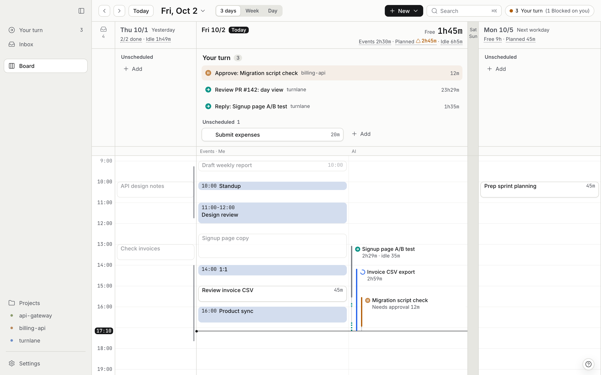
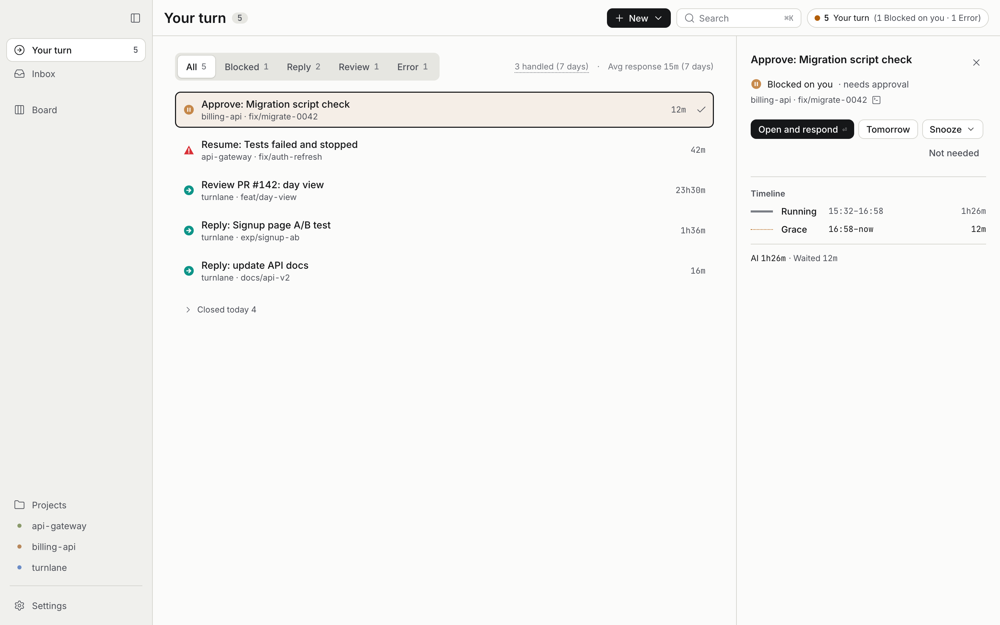
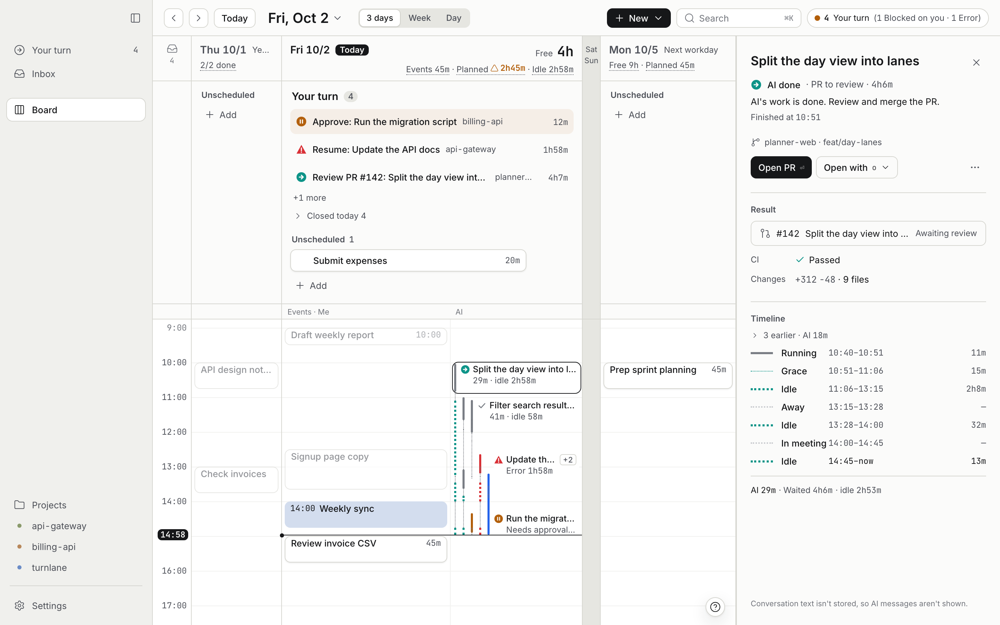

# Turnlane

**A daily planner for people who run AI coding agents.** Your calendar, your own tasks, and the work of Claude Code and Codex, in the terminal or in their desktop apps, sit on the same day lane. Nothing is typed in by hand: AI work is read from the agents' local files, and the moments an agent is waiting on you surface as *Your turn*.

> **0.7.0 is the first public release.** macOS only (macOS 14 or later, Apple Silicon). Install with Homebrew or the signed zip (below); [CHANGELOG.md](CHANGELOG.md) lists what changes between versions. Interfaces, file formats, and the CLI may still change before 1.0.



## What you see

- **Board** — three columns: the previous workday, today, and the next workday. Today has two lanes on a shared time axis: *Events · Me* (calendar events and your tasks) and *AI* (what Claude Code and Codex did, grouped by repository and branch). The header shows free time, planned time, and how long AI sat idle waiting for you. Leftovers from yesterday move to today with one click; if you plan more than fits, the number turns amber.
- **Your turn** — the queue of moments an agent needs you: a permission to approve, a question to answer, a PR to review, an error to resume. Items are created automatically from the agents' files and hooks and closed automatically when the agent moves on or the PR is merged. Each item shows how long you have been keeping the agent waiting.
- **Answer from Turnlane** — write your answer to an agent's question (or allow a permission) right from the waiting row; Turnlane types it into that session's terminal tab (tmux, Terminal, iTerm2, Ghostty, or Orca). If it can't confirm the agent picked it up, it brings the tab to the front. From the AI detail panel you can also send the next instruction to a session that is waiting at its prompt; Turnlane only types it while the agent is still running in that tab and its turn has ended (never into a shell after it exits). It never sends on its own, and what you write is not stored.
- **AI detail** — select any AI item to see its result (PR, CI, size of the change), what it needs from you, a timeline of running, waiting, idle, and in-meeting stretches, and the agent's last reply, read from the local log when you open it and never stored. What you asked and what it stopped on are stored.
- **Daily note** — the day's record (time breakdown, what you did, what AI did, what carried over) is kept automatically and available as Markdown from the day view, `turnlane report`, or the MCP server.

<p>
  
  
</p>

Screenshots use synthetic data from `scripts/dev-board.ts`.

## Install

Turnlane is a single `Turnlane.app` (menu bar item, notifications, quick add) plus a background daemon `turnlaned` and a CLI `turnlane`, all running on your Mac.

**With Homebrew** (recommended; signed and notarized):

```sh
brew install --cask turnlane/tap/turnlane
```

Then open Turnlane from Applications. The cask also puts `turnlane` on your PATH. Turnlane downloads new versions from GitHub Releases and installs them when you choose Restart to update (turn this off in Settings › General); `brew upgrade --cask turnlane` also works.

**From GitHub Releases:** download `Turnlane-<version>.zip` from the [Releases page](https://github.com/turnlane/turnlane/releases/latest), unzip it, and move `Turnlane.app` to Applications. `Turnlane-<version>.zip.sha256` holds the checksum (`shasum -a 256 -c Turnlane-<version>.zip.sha256`). To use `turnlane` in your shell, choose *Install* next to *Command line* on the last setup screen (or in Settings › General); it links `~/.local/bin/turnlane`.

**Uninstall.** Run `turnlane uninstall --all` first: it removes Turnlane's hooks and MCP entries from Claude Code and Codex, which `brew uninstall` cannot do. Then `brew uninstall --cask turnlane` (or move the app to the Trash). Your data in `~/Library/Application Support/turnlane/` stays; `brew uninstall --zap --cask turnlane` removes it too.

The first time you open it, macOS asks whether to open an app downloaded from the internet. The dialog should say that Apple checked it for malicious software (the release build is notarized). If macOS instead says it cannot verify the developer or that the app may contain malware, do not open it; download it again from the Releases page.
If you used an earlier build signed with a different certificate, macOS may ask again for Calendar and Automation access, or you may need to turn Turnlane on again in System Settings > Privacy & Security. `turnlane doctor` shows how the installed app is signed and notarized ([docs/dev/codesign.md](docs/dev/codesign.md) 5.6).

**From source** (Bun 1.4.x, Xcode command line tools, and Rust for the desktop shell):

```sh
git clone https://github.com/turnlane/turnlane.git
cd turnlane
bun install
bun run check          # lint, typecheck, tests
bun run build          # out/turnlaned and out/turnlane
out/turnlane self-install --dry-run   # shows what will be written
out/turnlane self-install             # ~/.local/bin + a LaunchAgent, then starts the daemon
turnlane open                         # opens the board (desktop app if installed, otherwise your browser)
```

Building `Turnlane.app` and the calendar helper from source: see [docs/dev/](docs/dev/).

## Using it

**Board.** Add a task with `New` (or from the `⌘K` command palette), drag it onto the time axis to plan it, drag it to another day to move it. Calendar events come from macOS Calendar (EventKit), so every account your Mac already has shows up; Turnlane can create and edit events there too.

**Your turn.** Items are generated from the agents' local files and from hooks (install below). `Open and respond` brings you to the terminal where the agent is waiting. Snooze, mark as handled, or say it is not needed.

**Ask AI.** From any task, press `Ask AI` to start Claude Code or Codex in a new tab of your usual terminal, in a fresh git worktree, with the task title, note, and your instructions as the first prompt. The run shows up as that task's AI work, and the task gets its own *Your turn* items and a quick check of the result (diff size, tests, CI).

**Daily note and MCP.** The record for any day is available as Markdown:

```sh
turnlane report                 # today's note as Markdown (--copy for the clipboard)
turnlane report 2026-10-02
turnlane today                  # events, tasks, Your turn
turnlane add "Reply to the design review" --date 2026-10-03 --est 30
```

The same data is exposed to agents through a stdio MCP server (`turnlane mcp`) with the tools `add_task`, `list_tasks`, `get_today`, `get_day`, `get_free_slots`, `schedule_task`, `complete_task`, `list_your_turn`, `get_ai_work`, `get_daily_report`, and `report_ai_work`, so a Claude Code or Codex session can add a task to your Inbox or read today's plan.

### Connect Claude Code and Codex

Turnlane works by reading the agents' local session files alone. Two optional installs make it faster and two-way:

```sh
turnlane hooks install   # hooks: tells Turnlane the moment an agent waits for permission or a reply
turnlane mcp install     # MCP: lets Claude Code / Codex add tasks to Turnlane and read your day
turnlane mcp status      # where it is registered (also shown by turnlane doctor)
```

Both commands apply to every Claude Code profile found (`~/.claude` and the `~/.claude-*` directories used with `CLAUDE_CONFIG_DIR`) and to Codex (`~/.codex`); narrow with `--claude-dir <dir>` / `--codex`, preview with `--dry-run`. Turnlane only adds and removes its own entries (tagged `--managed-by turnlane`), never touches other tools' hooks, and backs up each file before writing (`*.bak-turnlane-<timestamp>`). Restart a running agent to pick the change up; `turnlane hooks uninstall` / `turnlane mcp uninstall` remove it.

### Report from your own scripts and agents

Work that leaves no session log for Turnlane to read, such as your own scripts, cron jobs, or an agent running in a sandbox, can report its state itself. Each report shows up as AI work next to Claude Code and Codex, and a `waiting` report lands on *Your turn* right away:

```sh
turnlane ai report --source myscript --id nightly --title "Nightly export" --project Reports --state started
turnlane ai report --source myscript --id nightly --state waiting --kind question --text "Overwrite last night's file?" --option Overwrite --option "Keep both" --url https://example.com/runs/42
turnlane ai report --source myscript --id nightly --state done
```

`--source` is any lowercase name you choose; `--state` is `started`, `running`, `waiting`, `done`, or `error`. If Turnlane isn't running, the report is saved and read when it starts. The same report can be sent with the MCP tool `report_ai_work` or `POST /api/ai/reports`. For now you answer in your own tool: Turnlane shows the question and opens the `--url`.

## Supported agents

| Agent | Tested with | What is read |
|---|---|---|
| Claude Code | 2.1.x | `projects/**/*.jsonl` (metadata only), `sessions/*.json`, hooks |
| Codex CLI | 0.147–0.159 | `sessions/**/rollout-*.jsonl`, `session_index.jsonl` (the SQLite database is never opened), hooks |
| Claude Desktop app, Code tab | the Claude Code it bundles | the same files as Claude Code, in that Claude Code's config directory; nothing extra to set up |
| Codex app | the Codex it bundles | the same `~/.codex` files as Codex CLI; nothing extra to set up |

Chats in claude.ai, in the Claude app's chat view, or in the ChatGPT app are not read: those conversations are not stored on your Mac.

Each agent is an adapter in [`packages/collectors`](packages/collectors/README.md). Adapters are small, dependency-free, and tested against anonymized fixtures; adding another agent is the most useful contribution you can make. Open an [adapter request](https://github.com/turnlane/turnlane/issues/new?template=adapter_request.yml) first so the log format can be discussed without posting conversation text.

## Privacy

Turnlane is built so that you can check these claims in the code.

- **Everything stays on your Mac.** The daemon listens on `127.0.0.1` only. There is no account, no cloud sync, no telemetry, and no server run by the author. All data lives in `~/Library/Application Support/turnlane/`; `turnlane export --json` gets it all out again.
- **Conversation text never leaves your Mac.** Turnlane itself sends nothing to an LLM, a server, a relay, or telemetry; the two opt-in features that hand data to tools you already run (the daily note summary and the MCP server) are described below. From Claude Code and Codex sessions, Turnlane stores timestamps, repository, branch, and state, plus the session title the tool assigned (optional). Turnlane stores only, after masking secrets on a best-effort basis: the first line of each of your instructions (up to 120 characters), the question the AI asked you and its options, the tool and command (or file path) it asked permission for, and the error kind. That is what keeps an item's name stable all day and keeps it after Claude Code deletes its logs. AI replies, diffs, file contents, and copies of the session log are never stored. The daily record and its MCP tool may include these lines; the optional AI summary of your day never receives them. Turn storing off, or delete what is stored, in Settings › Data ([ADR 0018](docs/adr/0018-bounded-local-storage-of-wait-details.md), amending [ADR 0005](docs/adr/0005-no-ai-session-body-storage-or-transmission.md)). `turnlane doctor` audits the database for anything longer than these limits.
- **Answer from Turnlane.** When you answer a waiting item, the full question is read from the local session log only while the answer box is open, and your answer is typed into the session's own terminal tab on this Mac (for Terminal and iTerm2, macOS asks once to let Turnlane control the app). Neither is stored; the log keeps only the character count and which terminal it went to ([ADR 0019](docs/adr/0019-answer-from-turnlane.md)). The same goes for a next instruction sent from the AI detail panel: it is typed into the tab and not stored (only its first line is kept later, from the session log, like any instruction you type).
- **Reports from your own scripts and agents.** A report is written to a file in Turnlane's own data directory and read from there. Turnlane keeps its title, project, and link, and, when storing is on, the question or permission text and options cut to the limits above and masked the same way. It calls nothing back ([ADR 0021](docs/adr/0021-report-from-own-scripts-and-agents.md)).
- **Presence.** Idle time (how long you kept an agent waiting) only counts while you were at the Mac. Every 30 seconds the daemon reads two numbers: seconds since the last keyboard or mouse input, and whether the screen is locked. It stores only the start and end of each stretch of activity, never which keys or which apps ([ADR 0013](docs/adr/0013-presence-from-input-idle-only.md)).
- **Ask AI.** The prompt built from your task is handed to the `claude` or `codex` you already have installed, in your terminal, under your own account. Turnlane does not keep the prompt and does not talk to Anthropic or OpenAI itself ([ADR 0014](docs/adr/0014-ai-launch-via-launch-id.md)).
- **Daily note summary (opt-in, off by default).** If you turn it on, Turnlane runs your local `claude` or `codex` CLI with a fixed instruction and the day's Markdown note (task titles, AI work titles, repository names, PR numbers, durations, your notes). That request goes to the tool's provider through the tool itself, under your account. The run uses a scratch directory and a flag that does not save a session, and it is not counted as AI work.
- **MCP server (opt-in).** `turnlane mcp install` registers Turnlane with Claude Code and Codex. Any tool you connect it to can then add tasks and read your tasks, today's plan, AI work, and the daily record, including the stored lines above. Turnlane sends nothing on its own; what the connected tool does with what it reads is up to that tool. `turnlane mcp uninstall` removes the entry.
- **Update check and automatic updates.** The release build fetches one static file, `https://github.com/turnlane/turnlane/releases/latest/download/latest.json` (GitHub redirects it to the file attached to the latest release), once a day to tell you about new versions. When there is one, it downloads that release's zip from the same GitHub Releases (the `url` in `latest.json`; nothing outside GitHub), checks it against the sha256 in `latest.json`, Apple's code signature and notarization, and that it is signed by the same developer team as the app you are running, then installs it when you choose Restart to update or while the app isn't running. If any check fails, nothing is installed and you are pointed to `brew upgrade --cask turnlane` or the Releases page instead. Both requests are plain GETs with the user agent `turnlane/<version>`; no cookies, identifiers, or usage data are sent. The notarization check (`spctl`) normally works offline because the ticket is stapled to the app, but macOS may contact Apple when it can't find one. `turnlane config set update.download false` stops the download and install (you are only told about new versions); `turnlane config set update.check false` turns both off. Both are also in Settings › General. A build that includes an extension and a development install (`out/turnlane self-install`) never check. `turnlane doctor` shows whether the check and the download are on and what they last did ([ADR 0008](docs/adr/0008-mit-no-server-open-source.md)).
- **Extensions.** A future official build may include a separately licensed extension (Turnlane Pro); the current release does not. Only if one is included, that extension connects to polar.sh (`api.polar.sh`) to verify a license key, sending the key and a random per-Mac ID. A build from this repository contains no extension and makes no connection of its own apart from the update check and the update download; `gh`, `claude`, and `codex` run under your own account when you use the features that call them. See [ADR 0015](docs/adr/0015-extension-points-and-separately-licensed-additions.md).

## Turnlane Pro

Turnlane Pro is a planned, separately licensed extension of the official build; the current release does not include it. What it will add, and the waiting list, are at [turnlane.dev](https://turnlane.dev).

## Documentation

Specifications and decision records are currently written in Japanese; the code, UI, and CLI are in English.

| Document | Contents |
|---|---|
| [docs/spec/phase0-plan.md](docs/spec/phase0-plan.md) | Implementation plan: repository layout, schema, HTTP API, CLI, MCP tools, test strategy |
| [docs/spec/ai-session-ingestion.md](docs/spec/ai-session-ingestion.md) | How sessions are read per agent, state derivation, follow-ups, privacy rules |
| [docs/spec/ux-mvp.md](docs/spec/ux-mvp.md) | Screens, state model, shortcuts |
| [docs/design/](docs/design/README.md) | Final designs and the design system |
| [docs/adr/](docs/adr/) | Architecture decision records |

## Layout

| Name | Role |
|---|---|
| `turnlaned` | Background daemon (Bun + Hono + SQLite): ingestion, local API, serves the UI |
| `turnlane` | CLI: tasks, hooks endpoint, stdio MCP server, daemon management |
| `Turnlane.app` | Desktop shell (Tauri 2): window, menu bar, notifications, quick add |
| `TurnlaneCalendarHelper.app` | Small Swift helper that talks to EventKit |

## Contributing and support

- [CONTRIBUTING.md](CONTRIBUTING.md) — development setup, rules, how to add an adapter
- [SUPPORT.md](SUPPORT.md) — questions go to GitHub Discussions; bugs and adapter requests to the issue forms. `turnlane doctor --redact` prints shareable diagnostics with paths and names removed
- [SECURITY.md](SECURITY.md) — how to report a vulnerability privately

This is a side project maintained by one person. Issues and discussions are read, but there is no promise of a reply or a fix on any schedule.

## License

Turnlane is released under the [MIT License](LICENSE). Copyright (c) 2026 Rootstack Inc. Bundled third-party packages are listed in [THIRD_PARTY_NOTICES.md](THIRD_PARTY_NOTICES.md). Extensions included in the official build are licensed separately and are not part of this repository.
